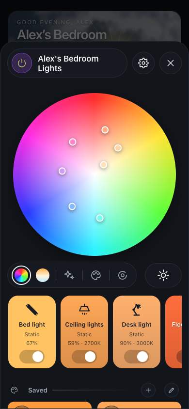
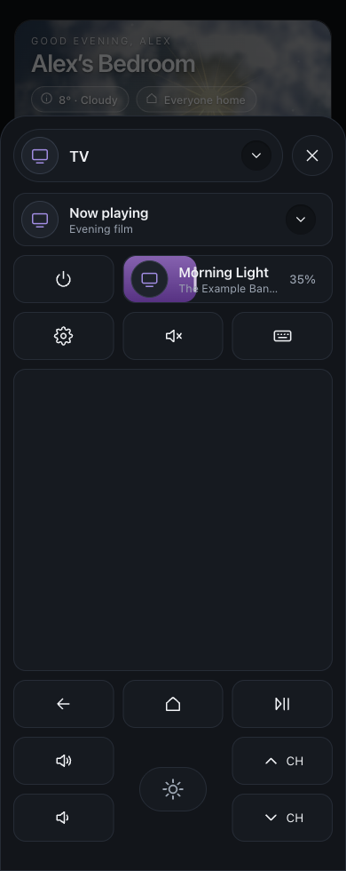
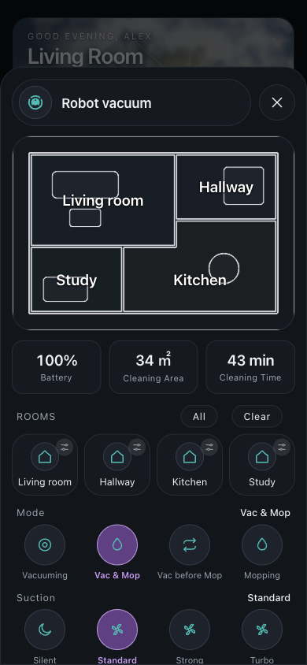
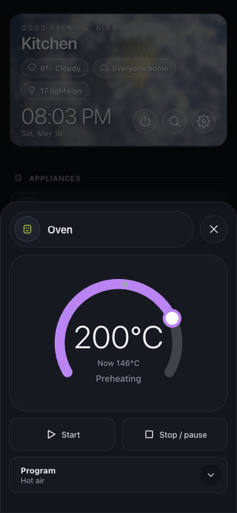
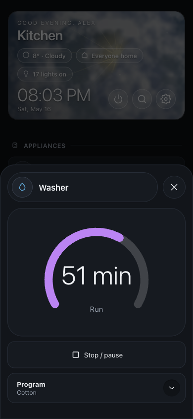
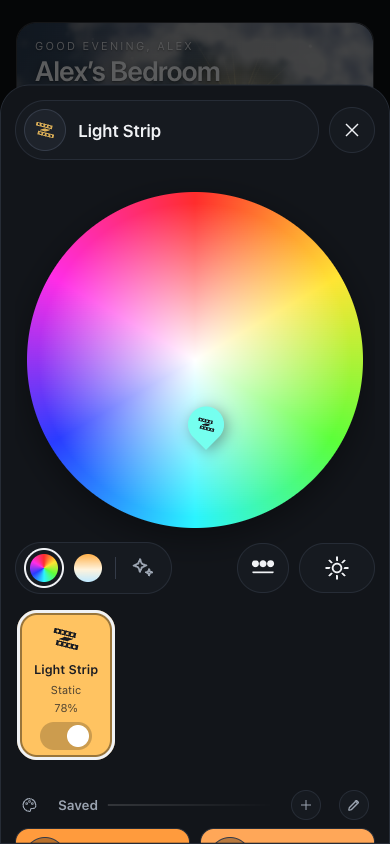
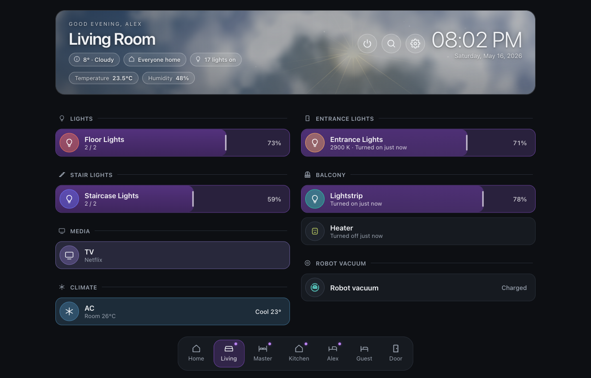

# Home Control

Home Control is a dashboard for Home Assistant. It adds a panel to your sidebar with a Home page and a page for each room, and you set it all up by clicking around in it. There's no YAML to write and no card collection to install.

### Lights, scenes and Hue sync

  
  
  

### Remotes and popups

  
  
  

  
  
  

## What it does

When you first open it, a short setup asks which rooms, lights and devices you want and builds the pages from your answers. After that you edit on screen: drag things around, rename them, add sections and widgets.

Tapping a device opens a popup made for that kind of device. It only shows what the device actually supports, so a fan without swing doesn't get a swing button.

Appliances (ovens, washers, fridges, projectors and so on) start from a template. If the template isn't quite right you can hide parts, reorder them or add more. If something doesn't fit any template, pick the whole Home Assistant device and the dashboard makes a popup from it. Buttons can run any Home Assistant action, and popups can open other popups.

There's also:

- Robot vacuums of any brand, with their map, rooms and cleaning settings ([how that works](docs/vacuum-appliance.md))
- TV remotes, a builder for your own, and one remote that drives a TV with its boxes and speakers
- Light groups, scenes, and animated scenes that move across a room
- Cameras and door calls
- A wall tablet mode, notifications, Siri and HomeKit
- Per-user access rules, and an "are you sure?" wherever you want one
- Backup and restore
- English and Turkish

  
  

## Installing

You need Home Assistant 2026.11 or newer for the Marketplace (older versions can use HACS). The repository isn't in the default list yet, so add it by hand:

1. Go to Settings → Marketplace → Add from link and paste `https://github.com/bora-yarkin/home-control`.
2. Download Home Control and restart Home Assistant.
3. Go to Settings → Devices & services → Add integration → Home Control.

The panel shows up in the sidebar. Its address, title, icon and who can open it are options of the integration. If you'd rather not use the Marketplace, copy `custom_components/home_control` into your configuration folder and restart.

It leaves your other dashboards alone. To make it the first thing you see, choose it under Profile → Default dashboard; Home Assistant keeps that setting per browser.

If you used an earlier version through a `panel_custom` entry in `configuration.yaml`, remove the entry first. Your layouts are kept.

## Documentation

- [User manual](docs/manual/README.md), also linked from Settings inside the dashboard
- [Setting it up with an AI assistant](docs/ai-setup.md)

If you have Philips Hue lights, [Philips Hue Plus](https://github.com/bora-yarkin/hue-plus) adds Hue's scenes, effects, gradient styles and Spotify sync to the dashboard.

## For developers

The dashboard is plain JavaScript with no build step, in `custom_components/home_control/frontend/`. The README there says what each file does. See [CONTRIBUTING](.github/CONTRIBUTING.md) before sending changes.

## Licence

GPL-3.0-or-later. The bundled Material Design Icons and hls.js are Apache 2.0 and keep their own licences in `frontend/mdi` and `frontend/vendor`.
