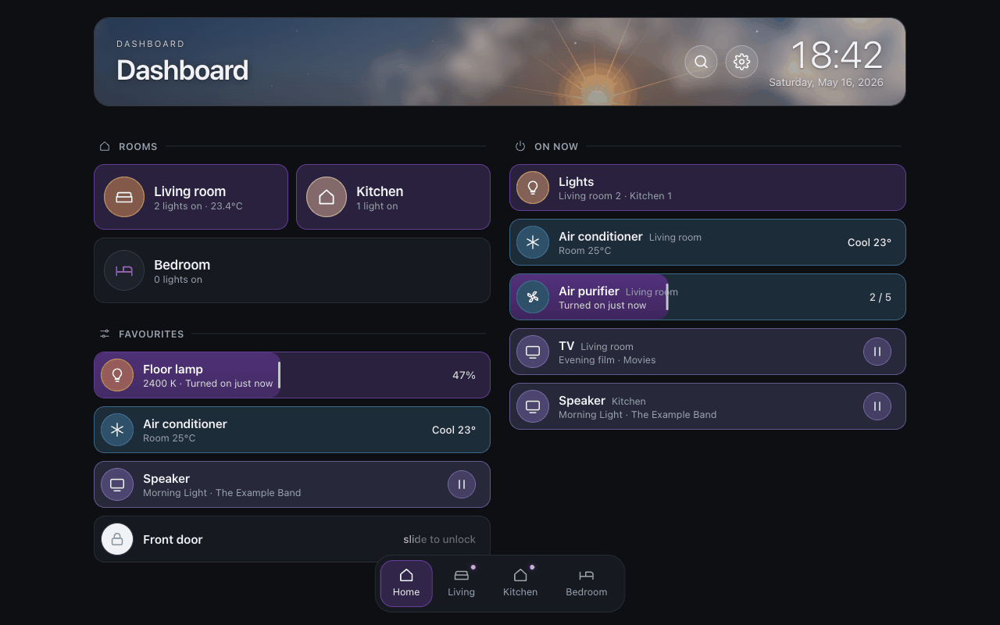
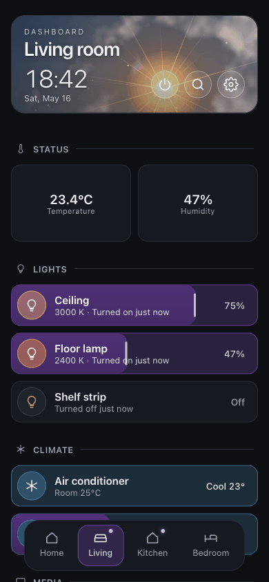
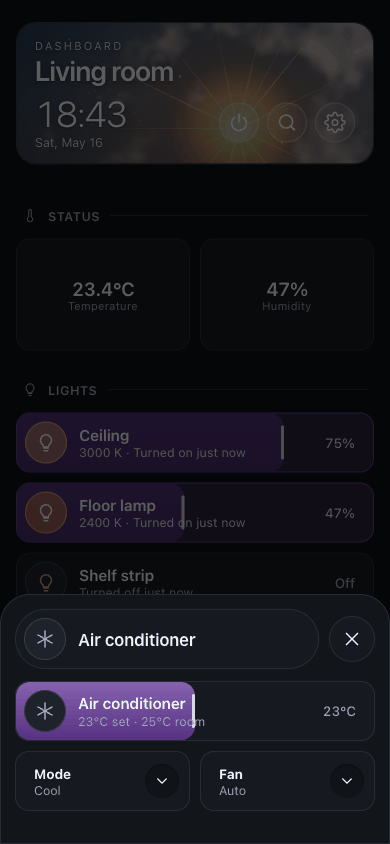
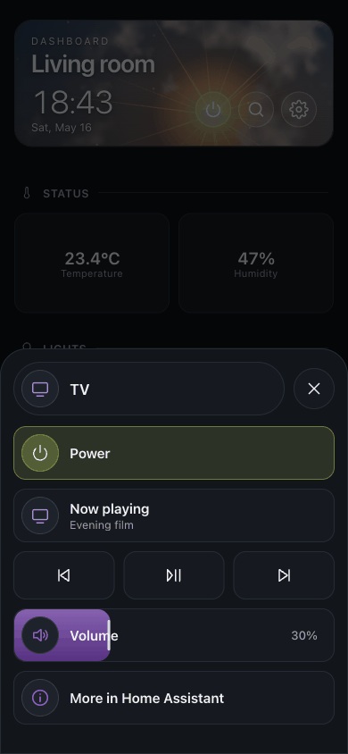
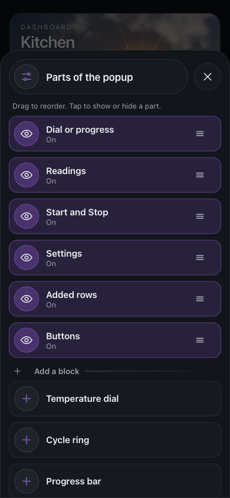

# Home Control

**A complete Home Assistant dashboard that you build by tapping, not by writing YAML.**

Rooms, lights and scenes, climate, TVs, cameras, appliances and robot vacuums, each with a popup made for it. It sits in your sidebar, works on a phone, a tablet and a wall screen, and needs no add-on cards.

  
  
  
  

*The screenshots show an invented demo home.*

## Why Home Control

- **Set up in minutes.** A guided first setup builds your pages from what you pick. Everything after that is edited on screen, with drag and drop.
- **Popups included.** Every device opens a popup made for its type, with only the controls that device reports. Nothing extra to install.
- **Your appliances, your way.** Ovens, washers, dryers, fridges, coffee machines, projectors and more start from a template. Reorder, hide or add blocks, each reading the entities you choose.
- **Build your own.** Add a whole Home Assistant device in one step, put popups inside popups, and make any button run any Home Assistant action.
- **Any robot vacuum.** Its map, rooms, cleaning settings and no-go zones are set up on screen, whatever the brand. See [the robot vacuum appliance](docs/vacuum-appliance.md).
- **Remotes.** Ready-made TV remotes, a remote builder with grids or a picture with touch areas, and one master remote for a TV, its boxes and its speakers.
- **Lights that go further.** Colour and temperature wheels, groups, masters, static and moving scenes for any light.
- **Made for a household.** Per-user access rules, "are you sure?" where you want it, notifications, a wall display and Siri and HomeKit scenes.
- **Careful with your home.** Commands that restart the system or run programs are for administrators and always ask first. Backups and restore are built in.
- **English and Turkish**, following Home Assistant's language or your choice.

  
  
  
  

## Install

Marketplace (Home Assistant 2026.11 and later; this repository is not in its default list, so add it yourself): *Settings → Marketplace → Add from link*, `https://github.com/bora-yarkin/home-control`; download *Home Control* (older versions: HACS, *Custom repositories*, category *Integration*), restart Home Assistant, then
*Settings → Devices & services → Add integration → Home Control*. The panel appears in the sidebar. The address, title,
icon and who may open it are options of the integration.

Adding it changes nothing else on your Home Assistant: your own dashboards, your default dashboard and your Hue setup stay as they are. The dashboard
appears in the sidebar; to open it first, choose it under *Profile, Default dashboard* (a setting of each browser, which an integration cannot change).

With [Philips Hue Plus](https://github.com/bora-yarkin/hue-plus) installed, the dashboard shows Hue Plus's lights, scenes and sensors and leaves out the
Hue integration's copies of them (matched by unique id), whether Hue Plus hid the Hue entities or left them alone. Without Hue Plus it shows the
Hue integration's as usual.

Without the Marketplace: copy `custom_components/home_control` into your configuration folder and restart.

If you used the dashboard before as a `panel_custom` entry in `configuration.yaml`, remove that entry first; your layouts
and settings are kept, because they live in Home Assistant, not in the files.

## Learn more

- **[User manual](docs/manual/README.md)**, also under *Settings → User manual* in the dashboard.
- **[AI setup guide](docs/ai-setup.md)**: lets an assistant build your dashboard as a file you restore.
- **[Philips Hue Plus](https://github.com/bora-yarkin/hue-plus)** adds Hue's scenes, effects, gradient styles and the Spotify sync. Parts that belong to one integration appear only when it is installed.

Home Control does not replace Home Assistant. Your automations, helpers and integrations stay where they are, and layouts and settings are stored by Home Assistant itself.

## How it is built

`custom_components/home_control/frontend/` is the dashboard (plain JavaScript, no build step); `README.md` there explains each
file. The integration (`__init__.py`) serves that folder and registers the panel.

## Licence

GPL-3.0-or-later. See `LICENSE`. The bundled Material Design Icons (Apache 2.0) and hls.js (Apache 2.0) keep their own
licences in `frontend/mdi` and `frontend/vendor`. Contributions: see `.github/CONTRIBUTING.md`.
