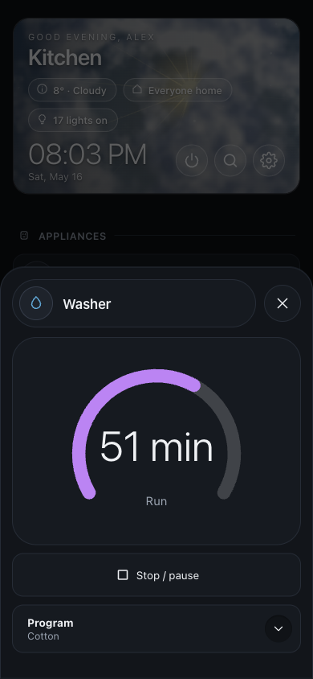
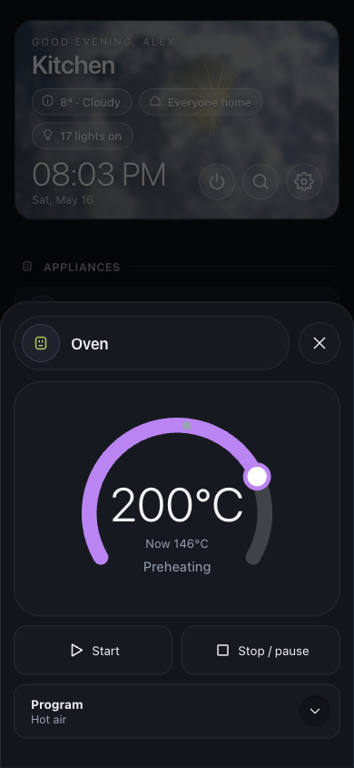
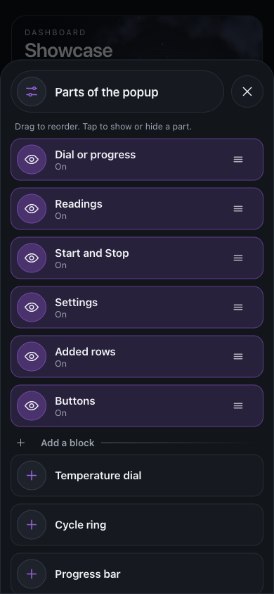
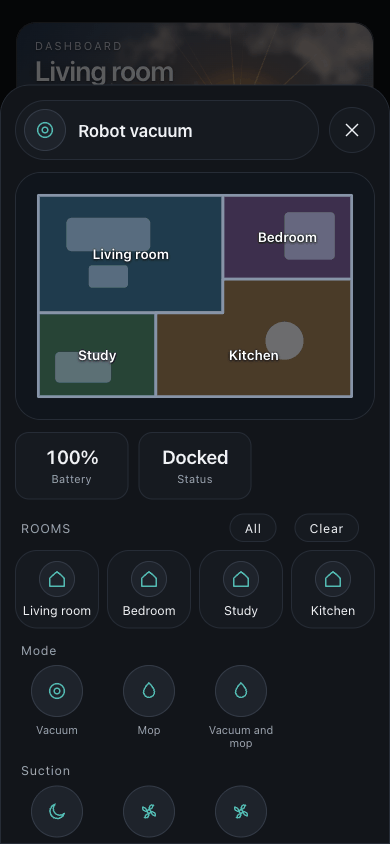

# Appliances and robot vacuums

## Appliances

 

Add item → Appliance, then pick a type. The type only decides what you're asked for first. In the appliance's setup, from the page editor, you choose:

- the entity for each slot (state, program, temperature, start, stop, time left, door and so on), which you can rename
- any extra rows, with your own labels and headings
- buttons or a picture from the [remote builder](media-and-remotes.md#the-remote-builder), useful for things like projectors

## Arranging the popup

Parts of the popup, in the appliance's settings, lets you drag parts around and hide the ones you don't want. Add a block puts in another temperature dial, cycle ring, progress bar, readings, Start and Stop, or settings tiles, each reading its own entities. That's how you'd show both fridge compartments, or a second oven.

## Custom devices

Custom device starts empty. Add any entity and it's drawn as its usual row, under headings if you like. A whole device does this for you: pick a Home Assistant device and you get its controls first, then readings, with settings and diagnostics under Details.

## Sharing

Save as a device file stores an appliance and anything added to its popup, with entity, device and area ids left out. Whoever loads it with From a device file picks their own entities and sees every action it can run before adding it. Names and text you typed stay in the file, so have a look before you share it.

Sections work the same way: Save as a preset file in a section's settings, and From a preset file when adding a section.

## Robot vacuums

You can add the vacuum entity itself (Add item → Vacuum). With `xiaomi_miot` and a `robot_vacuum_map` map you get room cleaning. Other vacuums get controls from what they report, and you can give them a map camera, room buttons and mode selects.

The other way is a robot vacuum appliance (Add item → Appliance → Robot vacuum), which works with any brand: live map, rooms, cleaning settings per room, no-go zones and your own Start actions. [The vacuum appliance guide](../vacuum-appliance.md) explains the whole thing, including the file format.
