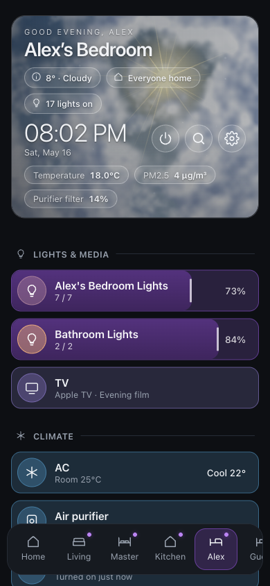

# Devices

## Adding

In the editor, tap Add item in a section, pick a type (and an area if you like), tick what you want and add it.

| Type | What you get |
|---|---|
| Lights | Lights, a lights master, or the ticked lights combined into a light group |
| Switches, Fans, Climate, Media, Vacuum, Cameras, Sensors, Controls, Helpers, All entities | Entities of that kind. Controls means numbers, selects, buttons, scripts, covers and locks |
| Scenes | Home Assistant scenes, dashboard scenes, a new scene or a scene collection |
| Remote | A ready-made remote, the Remote master, or one you build |
| Appliance | Ovens, washers, fridges, robot vacuums and more, see [appliances](appliances.md) |
| Widgets | See [widgets](widgets.md) |

## Device settings

Tap a device while editing. You can change its name, icon and size. Sensors, numbers and selects can be tiles, and a camera can show its live picture on the page.

Other options depend on the device: a light's saved state, whether a media player is a TV, receiver or speaker, a round dial for climate, slide-to-unlock for locks, treating a fan as an air purifier, and linked entities. You can also move or copy it, remove it or hide it.

## What works with what

Lights, switches, fans, climate, media players, vacuums, cameras, covers and locks have their own popups. Humidifiers, water heaters, alarm panels, valves, lawn mowers, sirens, updates, automations, text and date inputs, notify targets, weather, events, people, groups and remotes get controls based on what they report. For anything else, More in Home Assistant opens Home Assistant's own dialog.

Popups only show what a device supports. A thermostat with two target temperatures gets two sliders.

## Customize

In the editor, open the device and choose Customize:

- Icon colour, from the colour wheel or a code
- What tap, press and hold, and double tap do: open the popup, switch it, open Home Assistant's dialog, go to a page, run something, or nothing
- Ask before operating
- Your own state text, using `{state}`, `{name}`, `{attr:name}`, `{sensor.id}` or `{sensor.id:attribute}`, with different text when a condition is true
- Show only when up to four conditions are true

Settings → Defaults by type sets tap behaviour and asking for a whole type at once.

## Linked entities

Many devices come with extra entities, like a TV's remote or a purifier's filter life. Set up this device can find them or let you pick, and they then show in the popup.

## Adding to a popup

In a device's settings, Its popup lets you put anything under the popup's own controls: other devices, widgets, action buttons, template text, or more popups. Drag to reorder.

## Advanced settings

A popup can end with an Advanced settings button listing the other entities of the same Home Assistant device. Only administrators see it. You can turn it off for the whole dashboard (Settings → Devices), for one device (in its settings), or inside a Remote master.

Customise Advanced settings, in the device's settings, lets you reorder, hide, rename and add items, or reset to automatic.

## Light groups

Settings → Light groups creates, renames and deletes Home Assistant light groups. You can also tick lights while adding them and choose to add them as one group.

## New devices

When Home Assistant gets new devices, a dot appears on the settings button. Settings → Devices lets you add them to a room or ignore them.
