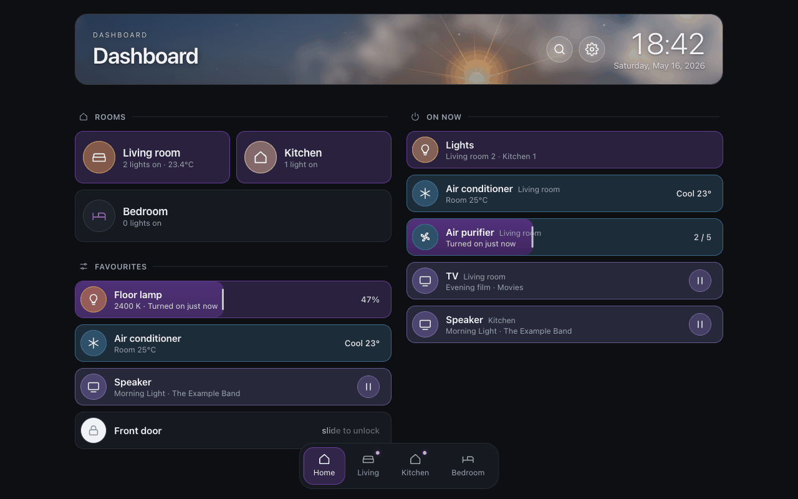

# Getting started

## Install

Add `https://github.com/bora-yarkin/home-control` to the Marketplace as a custom repository (Home Assistant 2026.11 or newer; use HACS on older versions). Download it, restart Home Assistant, then add the integration under Settings → Devices & services → Add integration → Home Control.

A panel appears in the sidebar. You can change its address, title and icon, or limit it to administrators, in the integration's options.

## The first run: guided setup

Before you start, give your devices areas in Home Assistant. The setup works from them. Then open the dashboard with an administrator account, since only administrators can save.

An empty dashboard opens the guided setup. It suggests something at each step, and you can change any of it:

1. Which areas get a page.
2. Which lights. It suggests a light group over the single lights inside it.
3. Whether rooms get a lights master, from how many lights (2 to 6), and which lights also get their own row.
4. Where scenes go: in the room's lights master, in a Scenes section, both or neither.
5. Which TVs and speakers. A second entry for the same box, such as a cast player, isn't suggested.
6. Climate, fans, blinds, locks, vacuums, cameras and switches. No switches are suggested.
7. A temperature and humidity sensor for each room's header.
8. What the Home page and header show.
9. A last check, then Create.

If you pick Not now, the dashboard stays empty and you can start later from Settings → Guided setup. Running it again replaces your pages. It downloads a backup first, and keeps room names, icons, scenes, notifications and access rules.

## Finding your way

The bar at the bottom switches between Home and your rooms. The header has the page name, the time, whatever you chose to show there, and buttons for Everything off (on room pages), Search and Settings.

Each row is a device. Tap the icon to switch it, or tap anywhere else on the row to open its popup. Some rows can be dragged sideways as a slider. Close a popup with ✕ or by tapping outside it. The arrow goes back one step.

## Changing the dashboard

Go to Settings → Editor to edit the page you're on. While editing, tapping an item opens its settings, you can drag items by their handles, and every section has an Add item button. Tap Done when you're finished.

Changes save as you make them. The message that pops up has an Undo button, and Settings → Backup and about → Change log keeps the last ten changes.

Everyone sees the same dashboard. Theme, accent colour and start page are per person, under Appearance.
