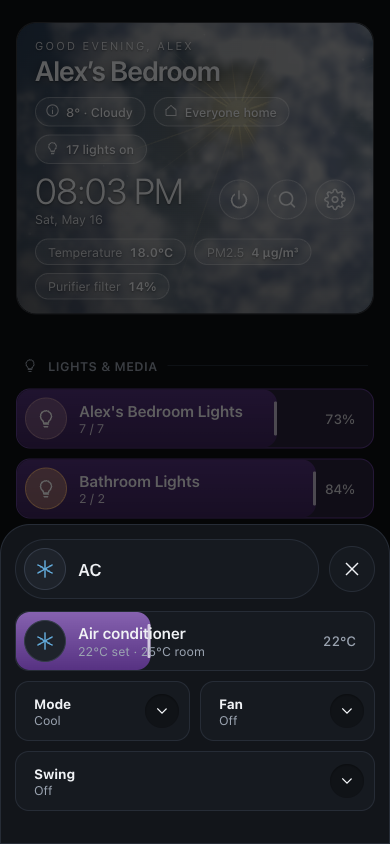

# Security, cameras, door calls, climate and energy

## Locks and alarms

The Security widget puts locks, alarm panels, doors and windows together. A lock can ask you to slide, and access rules can ask for confirmation.

## Cameras

Tapping a camera opens the live view (WebRTC, falling back to HLS). Set the size to Large to see the picture on the page. Link its pan, privacy and detection entities with Set up this device. Push to talk appears if the camera supports it.

## Door calls

Give an intercom camera its answer, reject, unlock and ring entities, and a call pops up with the picture and buttons when someone rings. [The intercom contract](../intercom-contract.md) lists what an integration needs to provide.

## Climate

Climate rows use a slider, or a dial if you prefer. Fans and air purifiers show speed, modes and linked readings.

## Energy and batteries

Energy and usage shows current power and the week so far. Choose which batteries to watch under Settings → Notifications. Low ones show up in Attention.
