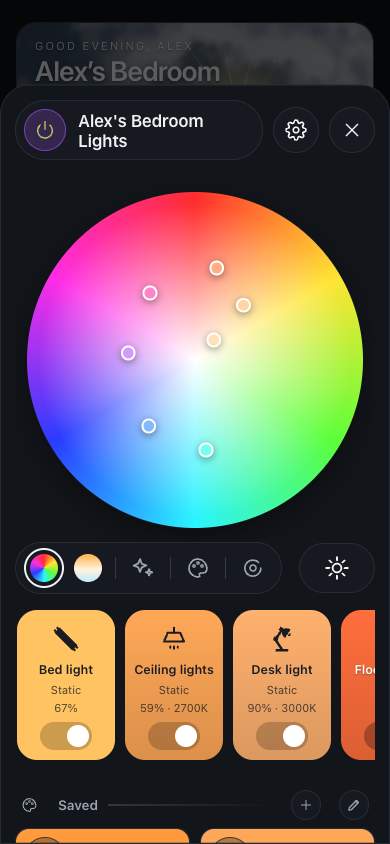
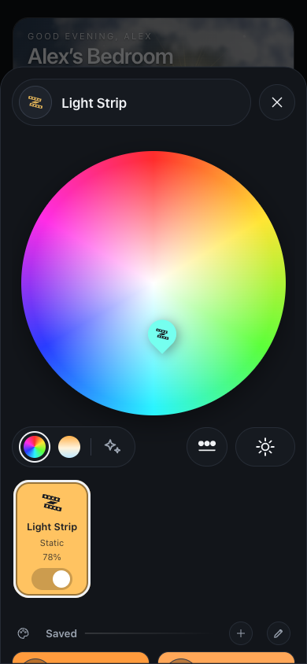
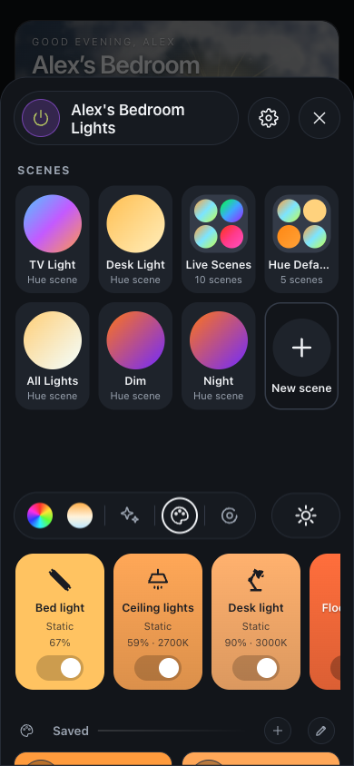
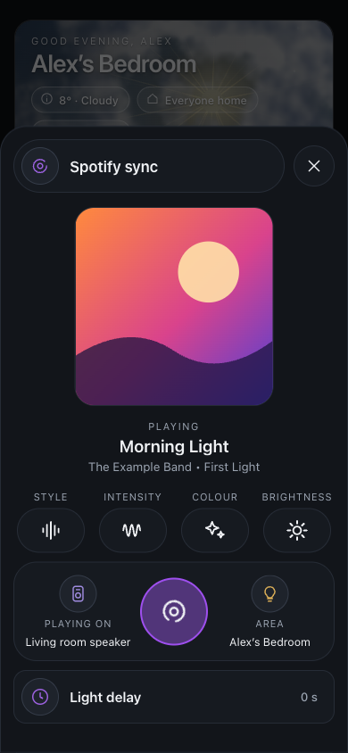

# Lights and scenes

## The light popup

 

Colour, white temperature, effects and brightness for one light or several. Gradient strips get a marker for each zone. The effects are the ones the light reports, and you can import more with an [effects file](../effects-file.md) under Settings → Effects.

## Lights masters

A lights master is one row that controls several lights together. Add it from Add item → Lights.

It can follow the lights of its section automatically, or you can pick any lights from any room and name them yourself. Its settings cover light order, showing groups as one tile, which tab opens first, hiding the section's single light rows, what the power button does (switch the lights or run a scene), a sync tab, and moving it elsewhere.

## Kinds of scene

 

| Kind | What it is | How to make one |
|---|---|---|
| Classic | Fixed settings for lights, climate, fans, media players and switches. It can start live scenes too | The + on the scenes, or Save the lights as they are |
| Auto | Up to ten colours with brightness, spread randomly over whatever you play it on. Tap again to reshuffle | New scene → Auto scene |
| Live | Colours and effects that move across the lights of an area | Make an area first, then New scene → Live scene |

Home Assistant's own scenes work too.

## Where to put scenes

- In a section, either one at a time or with a scene collection, which picks scenes by page, area or tag.
- In a lights master, on its Scenes tab. Choose where its scenes come from, drag to order them, and drop one on another to make a folder.
- On the Home page.

Tags help here: tag a scene in its editor, then include or leave out tags in a collection or master.

## Areas

Live scenes need to know where your lights are. Under Settings → Areas, pick a room, make an area and place each light left to right, back to front and floor to ceiling. Identify flashes a light so you know which one you're placing.

## Saved colours and defaults

You can save colours per room from the light popup, and give a light the state it should turn on with.

## Everything off

The power button on a room page turns off what's on that room's pages and stops its live scenes. In the editor it lets you choose what to leave on. Home Control also keeps a script per room, `script.home_control_<room>_off`, for automations and voice assistants.
