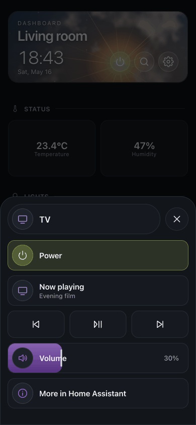

# TVs, speakers and remotes

## Media players

A media row opens now-playing, volume and sources. Set the **type** (TV, receiver, speaker) in the device's options. A TV with a `remote` entity linked gets a full
remote; *Set up this device* finds it.

Remote layouts exist for Samsung (`samsungtv_smart`/`samsungtv`), Apple TV and Android TV Remote, used on real devices by the author. Roku, Sony Bravia, Philips,
Vizio, Fire TV/ADB and LG webOS remotes are built from their integrations' documentation and marked experimental. Typing on the TV works only where the
integration offers it.

The built-in `samsungtv` integration reports no inputs; Samsung TV Smart (custom) does. Its input list is set in that integration's options.

## Adding a remote

In the editor, *Add item → Remote*:

- **Ready-made remote:** choose any media player. It goes on the page and tapping its row opens the remote. If the player has no remote entity of its own, you are asked
  which one sends its keys (a streaming box often has its player and its remote under different integrations); you can change it later under the device's linked entities.
- **Remote master:** one remote for a TV and what is plugged into it (below).
- **Build your own:** an empty remote for the builder.

## Buttons of the ready-made remotes

A button of a Samsung, Apple TV, Android TV or experimental remote shows only when the TV's integration can do it (a TV that says it cannot mute while it is on loses Mute; a TV whose integration cannot type has no keyboard).

*Edit the page → the TV → Remote buttons* (or, in a Remote master, the player's settings) changes any button:

- **Automatic**: as above.
- **Hidden**.
- **Use something else**, from any integration. A button takes a script, button, scene or switch, a key of a remote entity, or a media player's control. *Keyboard* takes a text field, a script (it gets `text`), or a remote or media player that can type. *Screen brightness* takes a number. *Apps and inputs* takes a media player's source list or a select.

What the integrations document for typing: Samsung only through `samsungtv_smart`; Apple TV (the keyboard must be open on the TV); Android TV Remote (turn on *Enable IME* in its options); Roku; Vizio. Sony Bravia, Philips, Fire TV (adb) and LG webOS document none, so their keyboard shows only when you give it a source. No integration documents setting screen brightness: the remote uses a `Backlight` number of the TV when there is one, else the number you choose.

## The remote builder

*Add item → Remote → Build your own* (or on an appliance, *Buttons*).

- **Grid:** choose columns, then add buttons: an entity to press, a key sent to a `remote` entity, a media player action or source, a five-way pad, a touchpad,
  now-playing, a source menu, a keyboard button, a slider, or a gap. Drag to reorder; set how wide and tall each is.
- **Look of the built-in remotes:** draws your grid with the buttons, spacing and touchpad of the Samsung and Apple TV remotes.
- **Picture:** upload a photo of your real remote (PNG, JPEG or WebP, at most 5 MB) or use a `/local/` file, then draw touch areas over its buttons.

## The Remote master

*Add item → Remote → Remote master*: it is one remote for the TV and what is plugged into it.

- **Default device:** usually the TV. Power belongs to it unless you pick another device.
- **Other devices:** each can be a media player or a custom remote, with the TV input it uses; picking it switches the TV to that input. Buttons a device does not
  have stay with the TV.
- **Speakers:** offered as volume sliders. Volume stays with the TV.
- The dropdown beside power switches devices without leaving the popup. It can remember your last pick.
- Each device in it can have its own name, icon, now-playing style, linked entities and button roles; you can build custom remotes inside it.
