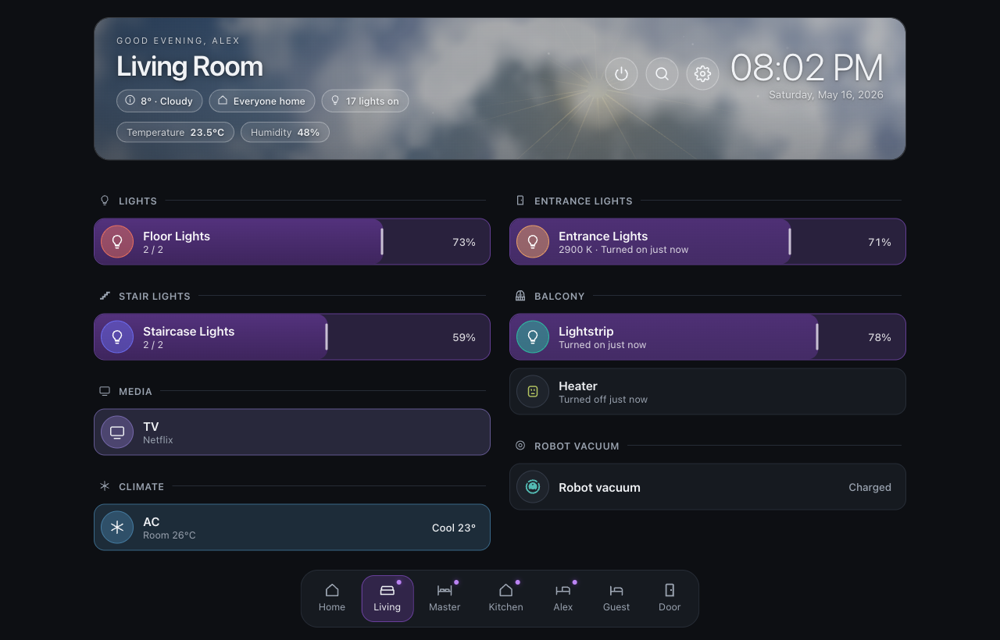

# Pages and sections

## Pages and rooms

There's a Home page and one page per room. In the editor, Page settings covers the name, icon, picture, which Home Assistant area the page stands for, how many columns it has, and hiding or deleting it. You can also add and reorder rooms from the editor.

## Sections

A page is made of sections. A section has a name and an icon and holds devices, widgets, lights masters and scenes in whatever order you like.

Add section creates one (room pages suggest a few), and Reorder sections moves them between columns. In a section's settings you can change its width on wide screens, show items as a list or a grid, hide it, or only show it under certain conditions.

## Columns

A page can have one to four columns. Screens narrower than 760 px always show one.

## Showing a section only sometimes

You can give a section conditions: a device's state, a sensor above or below a number, days of the week, a time window, daylight or dark, sunrise time, whether anyone is home, or which user is looking. All of them have to be true. While you're editing, the section always shows.

A condition can read any entity, either its state or one of its attributes.

## The header

Tap the header in the editor to choose the greeting, the line above the title and the clock. You can add up to four header items (weather, who's home, number of lights on, Attention, or any entity) and a weather sky behind it all, which each person can turn off.

Each page can also have up to six status tiles in its header, such as a temperature or air quality reading. One of them can be an Attention tile that only appears when something needs it. These are separate from the Status section, which is an ordinary section that shows sensors as tiles.

## Attention

The Attention widget lists low batteries, vacuum problems, and cameras, locks, air conditioners or lights that are unavailable. When there's nothing to report it hides, and so does a section left empty by that. You choose what counts in the widget's settings.
